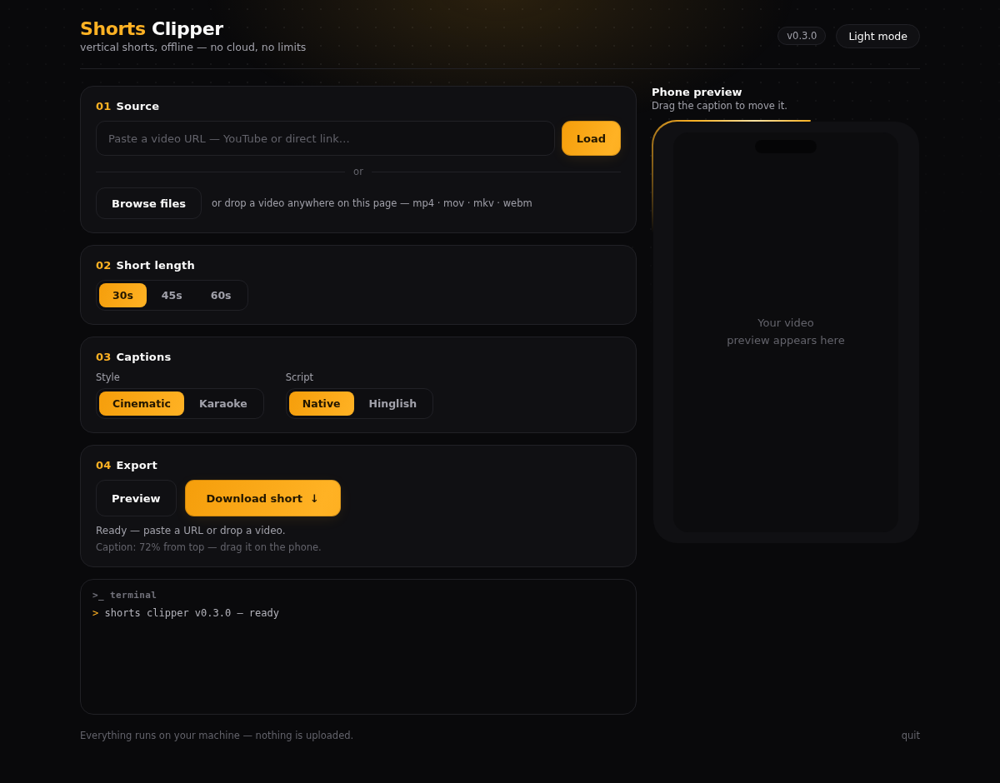

# Shorts Clipper

An original Linux desktop app that turns a long video into a vertical short:
paste a video URL or drop a local video, pick **30 / 45 / 60 seconds**, drag
the caption to where you want it on a phone preview, download the finished
**9:16** short. Everything runs on your machine — no cloud APIs, no
subscription, no usage limits.



**New in v0.3.0 — a brand-new UI.** The app now opens in your browser as a
local web app (Magic UI-style: dark by default, black + saffron-gold, light
mode one click away). Same fully-local pipeline underneath — nothing is
uploaded; the page is served from your own machine. Whisper's default model
is now `small` (correct Devanagari on Hindi/Hinglish audio — `tiny` could
crash and `base` mis-detected the language), captions get a heavier dark
outline so they stay readable on bright frames, and renders are atomic (an
interrupted run never leaves a corrupt mp4 that gets reused).

## What it does

1. **Input** — paste a video URL (YouTube or any direct video link) or drop a
   local video file onto the page (Browse button works too). The file is
   copied to the local cache — nothing leaves your machine.
2. **Auto-cut** — it transcribes the video and picks the single
   30/45/60-second window with the most spoken words (speech density). No LLM,
   no cloud, deterministic.
3. **Captions** — word-level timing from local Whisper, burned in as animated
   captions (cinematic or karaoke style, native script or Hinglish romanization).
4. **Phone preview** — the exact 9:16 center crop that gets exported, with the
   caption overlaid. **Drag the caption** up or down; the exported short burns
   it at the same position.
5. **Download** — renders to MP4 (H.264 + AAC) and your browser downloads it
   like any file.

## Quickstart

**AppImage (recommended):** download `ShortsClipper-x86_64.AppImage` from
[Releases](https://github.com/chinmayshastry05-cpu/shorts-clipper/releases),
make it executable, double-click it.

```bash
chmod +x ShortsClipper-x86_64.AppImage
./ShortsClipper-x86_64.AppImage
```

**From source:**

```bash
git clone https://github.com/chinmayshastry05-cpu/shorts-clipper.git
cd shorts-clipper
python3 -m venv .venv && . .venv/bin/activate
pip install -r requirements.txt
python -m shortsclipper            # opens the UI in your browser
# or headless:
python -m shortsclipper.cli --input <URL-or-file> --duration 30 --output out.mp4
```

## Requirements

- Linux x86_64, Python 3.10+
- `ffmpeg` + `ffprobe` on PATH (the AppImage bundles them)
- First run downloads the Whisper `small` model (~460 MB) to the Hugging
  Face cache — after that, cutting works fully offline.

## How it works

| Stage | Tool | Notes |
|---|---|---|
| Transcript | YouTube captions, else audio + Whisper | Captions need no media download; audio path downloads audio only |
| Auto-cut | Speech-density sliding window | Picks the densest 30/45/60s window; ties break earliest |
| Segment | yt-dlp `--download-sections` / ffmpeg slice | Only the chosen seconds are fetched for URLs |
| Captions | faster-whisper (CPU, small), word timings | Burned via libass `.ass` at the dragged position |
| Reframe | ffmpeg face-anchored crop + scale | OpenCV Haar face detect, median anchor; center crop when no face |
| Export | ffmpeg H.264 + AAC | `+faststart` for instant playback |

## Honest limits (v0.3)

- **Face tracking is one static anchor**, not per-frame tracking. The speaker's
  median face position across the short sets a single crop window. If the
  speaker moves around a lot, the median wins; if no face is found, the crop
  falls back to center. The preview shows exactly what you get.
- **YouTube may show a bot-check** ("Sign in to confirm you're not a bot") to
  datacenter / VPN IPs. On a normal home connection yt-dlp works; on a
  datacenter IP, paste a direct video link instead.
- **Transcription quality** is Whisper `small` on CPU — the smallest model
  that handles Hindi/Hinglish reliably (correct Devanagari). Slower than
  `tiny` (~3-4×), still fine for short-form cutting. Use `--whisper-model`
  (CLI) to change it.
- **One short per run.** Pick a new length to re-cut a different window.
- **TLS:** yt-dlp is told to prefer the system CA store, so machines whose
  proxy / corporate CA lives in the system store can still verify TLS.
  Verification is never disabled.

## Lineage

Built on the pipeline from
[paradox-clipper-pro](https://github.com/chinmayshastry05-cpu/paradox-clipper-pro)
(same author) — transcript-first segment fetching, word-timed captions, ASS
authoring — reworked for Linux (CPU Whisper, DejaVu Sans, XDG cache), with a
new GUI, a new LLM-free auto-cut, and draggable captions. The code, UI, and
branding here are original.

## Not affiliated

Shorts Clipper is an independent, original project. It is **not affiliated
with, endorsed by, or a port of** Mani Clips or any other commercial clipper.
All code, UI text, and branding in this repo are original.

## License

Apache-2.0 — see [LICENSE](LICENSE).
